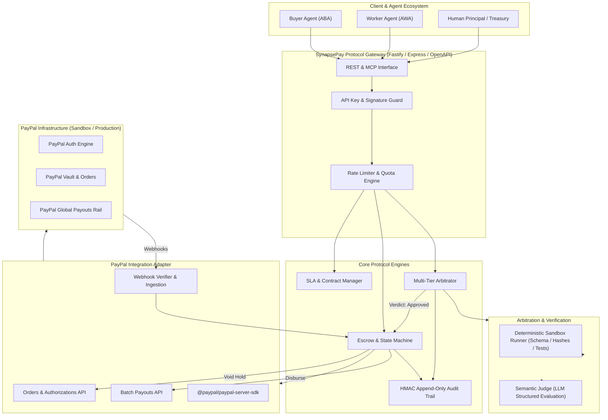
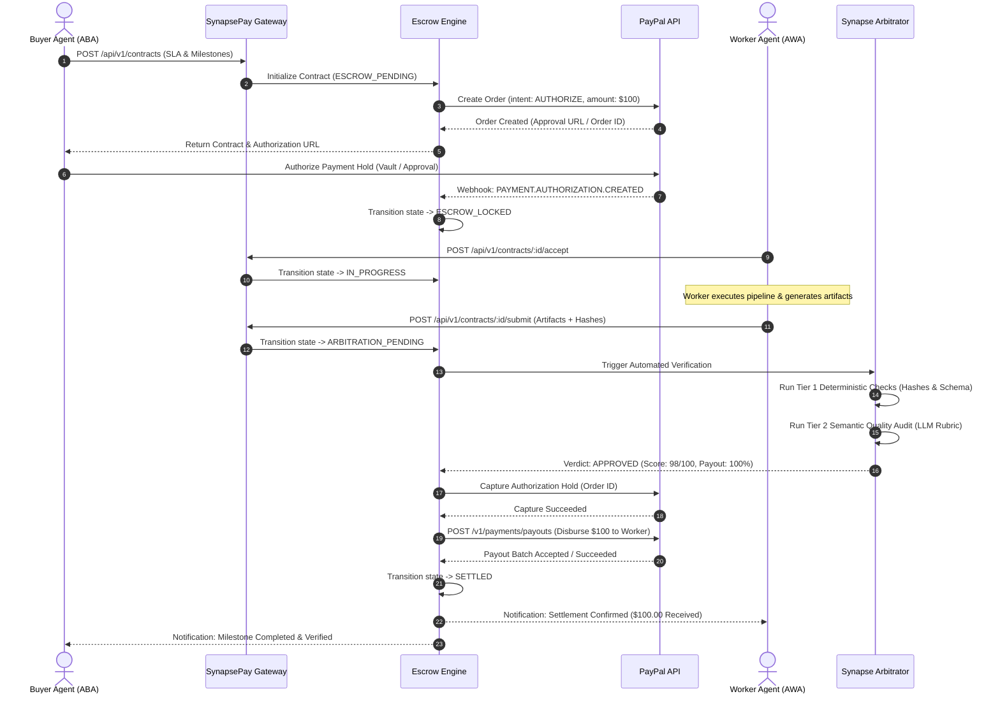
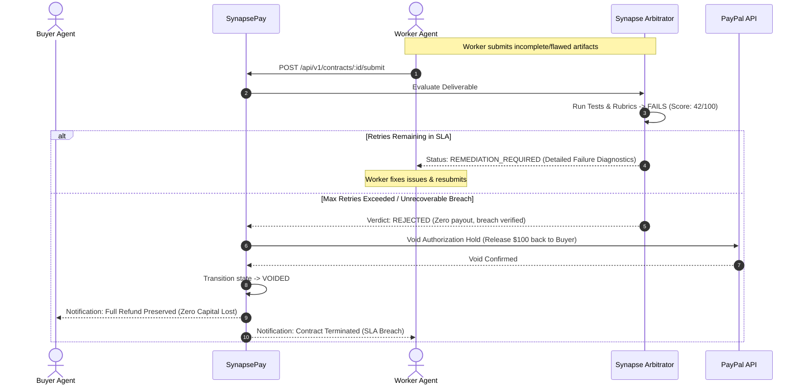

# SynapsePay: System Architecture & Technical Specification

**Specification Version:** 1.0.0  
**Status:** Approved for Implementation  
**Runtime Environment:** Node.js v20+ / v22+ / v24+ (TypeScript 5.x)  
**Primary Integration:** PayPal REST APIs (`@paypal/paypal-server-sdk`, `@paypal/agent-toolkit`)  

---

## 1. System Overview

**SynapsePay** is architected as a modular, event-driven, zero-trust autonomous settlement protocol. It decouples the negotiation and execution of agentic labor from the underlying financial movement, using PayPal's enterprise infrastructure as the authoritative custody, authorization, and payout rail.

### 1.1 Architectural Guiding Principles
1. **Stateless Financial Custody:** SynapsePay never directly touches, pools, or custodies fiat funds. Capital remains securely locked in PayPal authorization holds or is disbursed programmatically via PayPal Payouts directly into recipient PayPal accounts.
2. **Deterministic-First Arbitration:** Wherever possible, deliverables are verified through deterministic, reproducible checks (hash verification, schema validation, test suites). AI/LLM evaluation is applied strictly to qualitative/semantic criteria with calibrated rubrics and temperature `0.0`.
3. **Strict Idempotency:** Every payment action (escrow hold, capture, payout, void) is tied to a cryptographically unique idempotency key derived from the contract ID and milestone sequence to prevent duplicate transfers.
4. **Resilient Eventual Consistency:** In the event of network dropouts or asynchronous webhooks, the system self-heals by querying the authoritative PayPal Order/Payout status.

---

## 2. High-Level Architecture



---

## 3. Core Subsystems

### 3.1 SLA & Contract Management Engine
The SLA engine parses, validates, and serializes machine-readable agreements between autonomous agents.
* **Contract Specification (`ContractSpec`):** Encapsulates task parameters, pricing, deadline, dispute policies, and milestones.
* **Verification Specification (`VerificationSpec`):** A strictly typed declaration of:
  * **Deterministic Checks:** Expected SHA-256 hashes, JSON schema definitions, regex constraints, minimum unit test passes.
  * **Semantic Rubrics:** Criteria, scoring weights, minimum threshold (e.g. 85/100), and specific evaluation directives for the LLM judge.

### 3.2 Escrow & State Machine Engine
Maintains the authoritative state of each contract with strict transition guards:
* `DRAFT` $\rightarrow$ `ESCROW_PENDING` $\rightarrow$ `ESCROW_LOCKED` $\rightarrow$ `IN_PROGRESS` $\rightarrow$ `ARBITRATION_PENDING` $\rightarrow$ `SETTLED` (or `VOIDED` / `DISPUTED`).
* Implements distributed lock semantics to prevent concurrent state transitions.
* Interacts with the PayPal Adapter to trigger two-phase settlement:
  1. **Phase 1: Authorization Hold:** Order created with `intent: 'AUTHORIZE'`. Buyer approves; authorization ID stored.
  2. **Phase 2: Settlement Dispersal:** Once deliverable is verified, the hold is captured, and an atomic PayPal Payout (`/v1/payments/payouts`) is dispatched to the worker's PayPal receiver account.

### 3.3 Multi-Tier Arbitration & Verification Engine
* **Tier 1 (Deterministic Evaluator):**
  - Executes pure function checks on submitted payloads:
    - Verifies artifact hashes against claimed Blake3 / SHA-256 signatures.
    - Validates payload structures against provided Zod/JSON schemas.
    - Runs automated test assertions or validates test-runner reports.
* **Tier 2 (Semantic LLM Judge):**
  - Invokes LLMs (e.g., via Vercel AI SDK `generateObject` or standard structured output APIs) with zero temperature.
  - Injects: (a) Task Requirements, (b) Machine-Readable SLA Rubric, (c) Submitted Deliverable Artifacts.
  - Requires output strictly conforming to:
    ```typescript
    interface ArbitrationVerdict {
      decision: 'RELEASE' | 'REJECT' | 'PARTIAL_RELEASE';
      score: number; // 0 to 100
      passedChecks: string[];
      failedChecks: string[];
      rationale: string;
      payoutPercentage: number; // 0.0 to 1.0
    }
    ```

### 3.4 PayPal Integration Adapter
Encapsulates all direct communication with PayPal's REST endpoints:
* **Token Management:** In-memory cached OAuth2 bearer token with preemptive refresh 60 seconds prior to expiration.
* **Order Creation & Authorization:** Manages `/v2/checkout/orders` with `intent: 'AUTHORIZE'`.
* **Payouts Execution:** Manages `/v1/payments/payouts` with unique `sender_batch_id` preventing double-payouts.
* **Webhook Verification:** Cryptographically validates incoming webhooks using PayPal's `/v1/notifications/verify-webhook-signature` API or local certificate validation verifying:
  - `auth_algo`, `cert_url`, `transmission_id`, `transmission_sig`, `transmission_time`, and `webhook_id`.

---

## 4. End-to-End Sequence Diagrams

### 4.1 Happy Path: Contract, Escrow Hold, Execution, Audit, and Instant Payout



---

### 4.2 Failure & Remediation Path: SLA Breach and Autonomous Refund



---

## 5. Security & Threat Modeling

| Threat Vector | Attack Scenario | Mitigation in SynapsePay |
| :--- | :--- | :--- |
| **Worker Front-Running** | Worker claims payment before executing work. | Escrow payouts are physically impossible without an authenticated, signed arbitration verdict. |
| **Buyer Hold-Up** | Buyer refuses to acknowledge completed work to avoid paying. | Buyer has zero veto power over arbitration once the contract is locked. The independent Arbitrator controls disbursement. |
| **Arbitrator Collusion** | Tampering with evaluation prompts or scores. | Verification runs are logged with full input/output traces, deterministic test hashes, and HMAC signatures in the immutable audit log. |
| **Replay Attacks** | Resending valid webhook payloads or payout requests. | Idempotency keys enforced on every database mutation and PayPal Payout batch ID. |
| **Malicious Code Execution** | Worker submits malicious test suite or code payload designed to compromise the host. | Deterministic test runs execute inside ephemeral, unprivileged sandbox containers with network isolation. |

---

## 6. Directory Layout & Module Structure

```
SynapsePay/
├── Architecture.md           # This architecture & technical specification
├── Product.md                # Comprehensive Product Requirements Document (PRD)
├── package.json              # NPM configuration (TypeScript, latest packages)
├── tsconfig.json             # Modern TypeScript 5.x configuration
├── vitest.config.ts          # Vitest test runner configuration
├── .env.example              # Environment variables template
├── src/
│   ├── index.ts              # Core library export entrypoint
│   ├── server.ts             # HTTP REST API server entrypoint
│   ├── config.ts             # Strongly validated environment configuration
│   ├── types/
│   │   ├── contract.ts       # Contract, SLA, & Milestone domain schemas (Zod)
│   │   ├── escrow.ts         # Escrow states, events & ledger definitions
│   │   ├── arbitration.ts    # Verification rubrics & verdict schemas
│   │   └── paypal.ts         # PayPal API payload & webhook types
│   ├── core/
│   │   ├── state-machine.ts  # Formal Escrow state machine implementation
│   │   ├── audit-ledger.ts   # Cryptographic HMAC append-only audit trail
│   │   └── contract-manager.ts # SLA contract lifecycle orchestrator
│   ├── arbitration/
│   │   ├── deterministic.ts  # Tier 1 schema, hash, and assertion validator
│   │   ├── semantic.ts       # Tier 2 LLM rubric-based evaluator
│   │   └── arbitrator.ts     # Unified arbitration orchestrator
│   ├── paypal/
│   │   ├── client.ts         # Direct PayPal REST API client with OAuth2 caching
│   │   ├── orders.ts         # Order creation & authorization manager
│   │   ├── payouts.ts        # Payouts execution & batch tracking
│   │   └── webhook-guard.ts  # Webhook signature validation & event dispatcher
│   └── api/
│       ├── app.ts            # Fastify / Express application setup
│       ├── routes/
│       │   ├── contracts.ts  # Contract creation, retrieval, and status
│       │   ├── submissions.ts # Deliverable submissions & arbitration triggers
│       │   └── webhooks.ts   # PayPal webhook receiver endpoint
│       └── middlewares/
│           ├── auth.ts       # API Key & Bearer token guard
│           └── error-handler.ts # Standardized RFC-7807 error formatter
└── tests/
    ├── unit/
    │   ├── state-machine.test.ts # State transitions and guard invariants
    │   ├── deterministic.test.ts # Schema, hash, and assertion verifications
    │   ├── semantic.test.ts      # Rubric scoring and threshold verdicts
    │   ├── audit-ledger.test.ts  # Cryptographic audit log chaining
    │   └── webhook-guard.test.ts # Webhook signature validation logic
    └── integration/
        ├── contract-lifecycle.test.ts # Full end-to-end contract & escrow flow
        └── paypal-adapter.test.ts     # PayPal orders, authorizations & payouts
```
