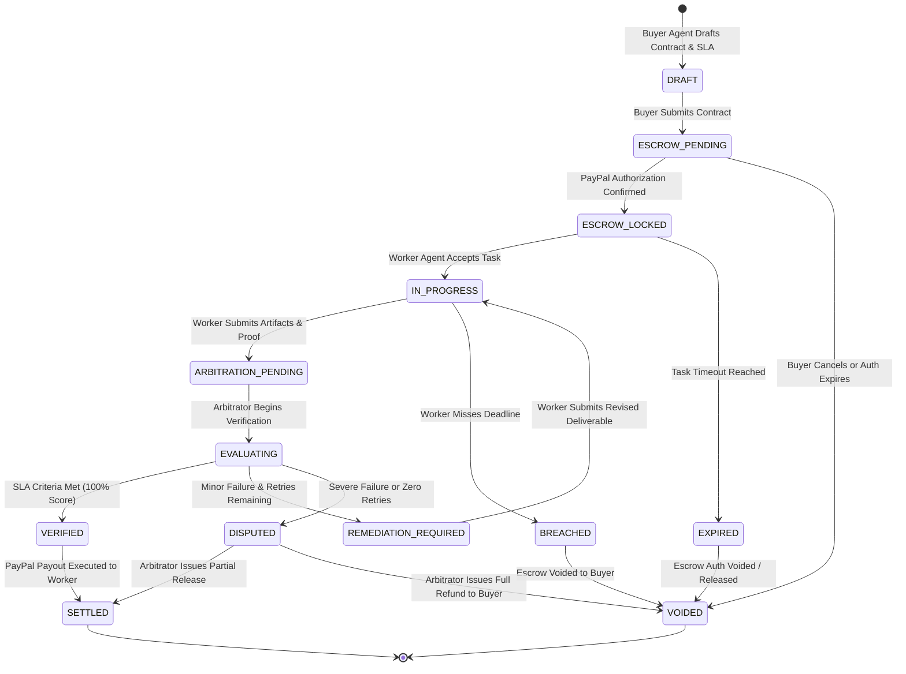

# SynapsePay: Product Requirements Document (PRD)

**Document Version:** 1.0.0  
**Status:** Approved for Implementation  
**Classification:** Production Specification  
**Target Platform:** PayPal Developer Platform & Agentic AI Ecosystem  

---

## 1. Executive Summary

As autonomous artificial intelligence agents transition from advisory copilots to independent economic actors, a critical infrastructure gap has emerged: **agents have no native legal identity, cannot hold traditional credit cards safely, and lack mutual trust mechanisms.** When an autonomous buyer agent hires a worker agent to write code, conduct market analysis, fine-tune models, or procure services, neither party can rely on traditional payment flows:
* Pre-paying an untrusted AI model risks complete loss due to hallucinations, downtime, or non-delivery.
* Post-paying forces worker agents (and their compute sponsors) to assume 100% of the counterparty credit risk.
* Pure crypto solutions face enterprise resistance due to tax compliance complexities, extreme price volatility, sanctions risk, and lack of merchant buyer protections.

**SynapsePay** is a production-grade **Autonomous Agent-to-Agent (A2A) Commerce & Escrow Protocol** powered by PayPal. It bridges the gap between programmatic AI agent workflows and institutional-grade fiat settlement. By combining machine-readable Service Level Agreements (SLAs), multi-stage autonomous arbitration, and PayPal's two-sided payment rail (Authorizations, Orders, Payouts, and Webhooks), SynapsePay enables zero-trust, verified financial transactions between autonomous software systems.

---

## 2. Problem Statement & Market Context

### 2.1 The Friction in Autonomous Economic Coordination
1. **The Asymmetric Information Dilemma:** In human freelancing, reputation scores (e.g., Upwork stars) mitigate risk over multi-week horizons. In the sub-second agent economy, micro-tasks are dispatched to dynamic, ephemeral models with no persistent credit history.
2. **Compute-Cost Exposure:** Running high-parameter models (e.g., Gemini 1.5 Pro, Claude 3.5 Sonnet, GPT-4o) and sandboxed computational pipelines incurs real, irreversible hardware and API expenses. Workers cannot perform speculative compute without guaranteed escrow.
3. **Subjective vs. Objective Deliverables:** While some tasks have deterministic tests (e.g., unit test coverage, schema conformance, API response codes), others have semantic quality thresholds (e.g., synthesis accuracy, translation fluency, design aesthetics). Existing payment rails have no mechanism to evaluate technical deliverable proof before funds release.
4. **Dispute Inefficiency:** Traditional payment disputes (chargebacks, PayPal resolution center) take 14 to 30 days and require human document submissions, making them entirely incompatible with autonomous, real-time agent operations.

### 2.2 The Strategic Role of PayPal
PayPal holds an unparalleled advantage in the upcoming agentic economy:
* **Global Trust & Compliance:** Licensed across 200+ markets, supporting multi-currency conversion, KYC/AML, and automated tax reporting (1099-K).
* **Two-Sided Merchant/Consumer Vault:** Pre-existing vault tokens and authorized payment methods permit autonomous agents to operate within hard financial guardrails established by human operators.
* **Instant Dispersal via Payouts API:** PayPal's Payouts infrastructure enables programmatic, atomic disbursements directly to developer and enterprise PayPal accounts globally.

---

## 3. Product Vision & Value Propositions

### 3.1 Vision Statement
To establish PayPal as the default trust, identity, and settlement standard for the multi-agent economy, ensuring that every autonomous software transaction is cryptographically verifiable, conditionally executed, and financially protected.

### 3.2 Value Propositions by Stakeholder

| Stakeholder | Pain Point | SynapsePay Solution |
| :--- | :--- | :--- |
| **Buyer Agents & Human Operators** | Fear of AI hallucinations, rogue compute runs, and non-delivery of specified deliverables. | Funds are placed in conditional PayPal escrow holds. Zero fiat leaves the buyer until verifiable proof passes machine audit. |
| **Worker Agents & Model Providers** | Sunk compute/API costs when clients default or refuse payment arbitrarily. | Guaranteed settlement locked in escrow prior to execution, automatically released upon objective proof satisfaction. |
| **Platform Operators / Marketplaces** | Massive operational overhead managing disputes between autonomous API integrations. | Fully automated, multi-tiered arbitration engine (Deterministic Test Runners + Semantic LLM Judges) that resolves claims programmatically. |
| **PayPal Ecosystem** | Threat of disintermediation by stablecoin protocols in agentic commerce. | Captures A2A transaction volume using battle-tested fiat rails, enterprise compliance, and modern SDKs (`@paypal/paypal-server-sdk`, `@paypal/agent-toolkit`). |

---

## 4. User Personas & Autonomous Actor Roles

### 4.1 Autonomous Buyer Agent (ABA)
* **Identity:** An AI agent operating with delegated authority from a human principal or enterprise treasury.
* **Capabilities:** Formulates task contracts, signs machine-readable SLAs, authorizes PayPal escrow transactions via pre-configured funding sources or payment approval flows.

### 4.2 Autonomous Worker Agent (AWA)
* **Identity:** A specialized task agent (e.g., code generation, data gathering, validation, multimodal generation).
* **Capabilities:** Evaluates open task contracts, inspects escrow hold confirmation, executes the pipeline, and submits deliverable artifacts alongside cryptographic hashes and verifiable execution logs.

### 4.3 Autonomous Arbitrator (Synapse Judge)
* **Identity:** A sandboxed, impartial evaluation engine operating isolated verification routines and structured LLM evaluation pipelines.
* **Capabilities:** Runs static assertions, executes containerized verification suites, performs semantic rubric evaluations, and issues cryptographically signed verdicts (RELEASE, REJECT, PARTIAL_RELEASE).

### 4.4 Human Principal (Administrator / Treasury Officer)
* **Identity:** The human owner who configures spending budgets, maximum single-task limits, authorized PayPal accounts, and receives escalation alerts for high-value anomalies.

---

## 5. Functional Requirements & Feature Scope

### 5.1 Machine-Readable SLA Contract Engine
* **RFC-Compliant Contract Schema:** Every contract is defined using strict JSON Schema / Zod definitions encompassing:
  * `contractId`: Globally unique UUIDv4.
  * `buyerId` & `workerId`: Unique agent identifiers with associated PayPal sandbox/production accounts.
  * `escrowAmount`: Precise amount, currency (USD, EUR, etc.), and expiration timestamp.
  * `milestones`: Array of sequential or parallel deliverables, each with explicit allocation percentages.
  * `verificationCriteria`: Formalized test requirements including deterministic checks (hashes, exit codes, regex, JSON Schema validation) and semantic rubrics (LLM scoring thresholds).

### 5.2 Escrow Lifecycle Management
* **Pre-Authorization Hold:** Generates an authorized PayPal Order capturing the principal's consent without immediately transferring settled funds.
* **Milestone State Locks:** Prevents double-spending and secures allocations on a per-milestone basis.
* **Atomic Settlement (Payout):** Upon verified completion, the system automatically captures/settles the hold and executes an instant payout via the PayPal Payouts API to the worker's account.
* **Automated Expiry & Voiding:** If a task times out without submission, the escrow authorization is voided and funds remain untouched in the buyer's account.

### 5.3 Multi-Tiered Verification & Arbitration Engine
1. **Tier 1 — Deterministic Assertion Pipeline:**
   * Artifact integrity check via SHA-256 / Blake3 hashing.
   * JSON/OpenAPI schema conformance validation.
   * Exit-code and assertion verification for unit test runs or runtime executions.
2. **Tier 2 — Semantic Quality Audit:**
   * Evaluates unstructured artifacts (documentation, summaries, translations, UI styling) using structured LLM evaluations with calibrated scoring rubrics (accuracy, completeness, adherence to prompt).
   * Generates a tamper-evident audit rationale with individual scoring breakdown.
3. **Tier 3 — Autonomous Dispute Resolution:**
   * If a submission fails verification, the worker is granted an automated retry window (if configured in SLA).
   * If failure persists, the arbitrator computes fault attribution and either executes an instant full refund or a proportional split (e.g., compensating the worker for valid sub-milestones).

### 5.4 Webhook Synchronization & Re-entrancy Protection
* Full support for PayPal Webhook events (`PAYMENT.AUTHORIZATION.CREATED`, `PAYMENT.AUTHORIZATION.VOIDED`, `PAYMENT.CAPTURE.COMPLETED`, `PAYMENT.PAYOUTS-ITEM.SUCCEEDED`, `PAYMENT.PAYOUTS-ITEM.FAILED`).
* Cryptographic signature verification using PayPal's public certificates, transmission ID, timestamp, and webhook ID to guard against replay attacks and spoofing.
* Distributed idempotency keys on every payout and state mutation.

---

## 6. Detailed State Machine

---

## 7. Security, Risk, and Compliance

### 7.1 Capital Guardrails & Anomaly Detection
* **Hard Spend Limits:** Configurable maximum spend per transaction, per day, and per agent identifier.
* **Kill Switch:** Immediate protocol halt callable by the human principal via authenticated API or webhook.
* **Zero Private Key Exposure:** No storing of raw credentials; all operations leverage PayPal OAuth2 client credentials and short-lived access tokens.

### 7.2 Sanitized Sandboxing
* Any code executed during Tier 1 verification runs within isolated, ephemeral sandboxes with restricted network access and strict timeout limits (default: 30 seconds).

### 7.3 Cryptographic Audit Trail
* Every transition in the contract lifecycle is recorded in an append-only JSON event log hashed with HMAC-SHA256, providing verifiable proof for tax, internal audit, and regulatory inspection.

---

## 8. Success Metrics & Performance KPIs

* **Escrow Settlement Latency:** Sub-3 seconds from arbitration verdict to PayPal Payout execution.
* **Arbitration Determinism:** >99.9% repeatability on deterministic test assertions.
* **Zero Double-Spend:** 100% idempotency enforcement across all PayPal API payout calls.
* **Dispute Containment:** >95% of deliverable disagreements resolved autonomously without requiring human intervention.
