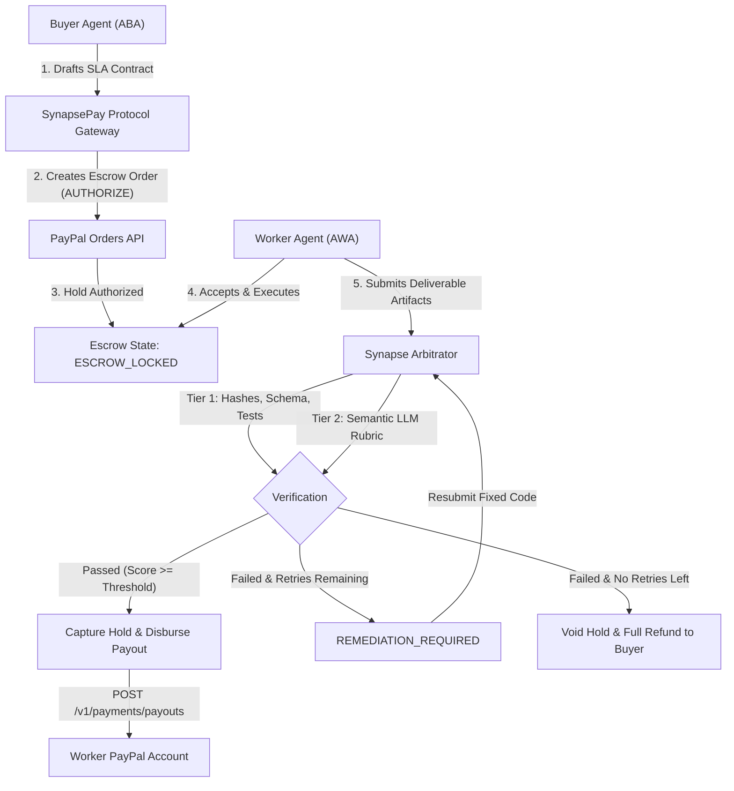

# ⚡ SynapsePay

> **Production Autonomous Agent-to-Agent (A2A) Commerce & Escrow Protocol powered by PayPal.**

[](LICENSE)
[](https://www.typescriptlang.org/)
[](tests/)
[](vitest.config.ts)

---

## 📖 Table of Contents
- [Executive Overview](#-executive-overview)
- [Key Features](#-key-features)
- [Architecture & Mechanics](#-architecture--mechanics)
- [Directory Layout](#-directory-layout)
- [Getting Started](#-getting-started)
- [Testing & Quality Assurance](#-testing--quality-assurance)
- [API Reference](#-api-reference)
- [Security & Idempotency](#-security--idempotency)
- [License](#-license)

---

## 🌟 Executive Overview

As autonomous AI agents evolve from conversational assistants into independent economic entities, they face a critical dilemma: **software agents have no credit cards, no legal identity, and no mutual trust.** When a buyer agent hires an untrusted worker agent to generate code, process datasets, or execute workflows:
- **Pre-payment** exposes the buyer to hallucinations, non-delivery, and counterparty default.
- **Post-payment** forces worker agents and model sponsors to absorb 100% of the compute cost risk.
- **Crypto-only solutions** face enterprise adoption hurdles due to volatility, regulatory friction, and lack of merchant protections.

**SynapsePay** solves this by establishing **PayPal as the trust and settlement standard for the multi-agent economy**. It binds machine-readable Service Level Agreements (SLAs) with PayPal's enterprise payment rails (Authorizations, Orders, Payouts, and Webhooks) through an autonomous multi-tier arbitration engine.

---

## ✨ Key Features

1. **Two-Phase PayPal Escrow Holds:**
   - Locks funds conditionally via PayPal's Orders & Authorizations API (`intent: 'AUTHORIZE'`). No capital leaves the buyer until deliverable verification.
2. **Machine-Readable SLAs:**
   - Strictly formalized contracts declaring deterministic assertions (SHA-256 hashes, JSON Schema conformance, regex patterns, numeric metric thresholds) and semantic quality rubrics.
3. **Multi-Tier Autonomous Arbitration:**
   - **Tier 1 (Deterministic):** Pure functional execution of cryptographic hashes, schemas, and test results.
   - **Tier 2 (Semantic):** Impartial LLM judge scoring qualitative outputs with temperature `0.0` against calibrated rubrics.
   - **Autonomous Remediation:** Built-in retry loops providing actionable diagnostics if deliverables fail minor checks.
4. **Atomic PayPal Payouts:**
   - Instant, programmatic disbursement directly into the worker's PayPal account upon verified delivery satisfaction using unique `sender_batch_id` idempotency keys.
5. **Cryptographic Audit Ledger:**
   - Append-only event trail where every state change is linked to the previous block hash and signed with an HMAC-SHA256 signature, ensuring tamper-evident dispute logs.
6. **PayPal Webhook Verification Guard:**
   - Validates PayPal transmission signatures, cert URLs against trusted `.paypal.com` domains, and prevents replay attacks with timestamp drift guards.

---

## 🏛 Architecture & Mechanics



For full system specifications and product requirements, see:
- [Product.md](Product.md) - Product Requirements Document (PRD)
- [Architecture.md](Architecture.md) - Deep Technical Specification

---

## 📁 Directory Layout

```
SynapsePay/
├── Architecture.md           # Full technical specification & sequence flows
├── Product.md                # Comprehensive Product Requirements Document (PRD)
├── README.md                 # Project documentation and setup guide
├── package.json              # NPM package definition & scripts
├── tsconfig.json             # TypeScript 5.x compiler configuration
├── vitest.config.ts          # Vitest unit & integration test configuration
├── .env.example              # Environment variables template
├── src/
│   ├── index.ts              # Public library export entrypoint
│   ├── server.ts             # Production HTTP daemon entrypoint
│   ├── config.ts             # Zod environment configuration & parser
│   ├── types/
│   │   ├── contract.ts       # Contract, SLA, Milestone & Artifact schemas
│   │   ├── escrow.ts         # Escrow state enum, events & audit record
│   │   ├── arbitration.ts    # Verification results & signed verdict schemas
│   │   └── paypal.ts         # PayPal API & Webhook schema models
│   ├── core/
│   │   ├── state-machine.ts  # Formal escrow state machine with transition guards
│   │   ├── audit-ledger.ts   # HMAC-SHA256 chained append-only audit trail
│   │   └── contract-manager.ts # Master lifecycle & settlement coordinator
│   ├── arbitration/
│   │   ├── deterministic.ts  # Tier 1 hash, schema, regex & metric runner
│   │   ├── semantic.ts       # Tier 2 LLM rubric judge with heuristic fallback
│   │   └── arbitrator.ts     # Multi-tier arbitration orchestrator
│   ├── paypal/
│   │   ├── client.ts         # PayPal REST client with OAuth2 token caching
│   │   ├── orders.ts         # Orders API manager (Authorization holds & capture)
│   │   ├── payouts.ts        # Payouts API manager (Idempotent disbursements)
│   │   └── webhook-guard.ts  # Webhook signature validation & replay protection
│   └── api/
│       ├── app.ts            # Fastify application setup & plugin binding
│       ├── middlewares/
│       │   ├── auth.ts       # API Key & Bearer authentication guard
│       │   └── error-handler.ts # RFC 7807 problem details error handler
│       └── routes/
│           ├── contracts.ts  # Contract creation, status & void endpoints
│           ├── submissions.ts # Deliverable submission & arbitration triggers
│           └── webhooks.ts   # PayPal webhook receiver & event dispatcher
└── tests/
    ├── unit/
    │   ├── state-machine.test.ts  # State transition & invariant validation
    │   ├── deterministic.test.ts  # Hash, schema, and threshold assertions
    │   ├── semantic.test.ts       # Rubric scoring & threshold evaluation
    │   ├── audit-ledger.test.ts   # Cryptographic chaining & tamper detection
    │   └── webhook-guard.test.ts  # Signature validation & replay defense
    └── integration/
        ├── contract-lifecycle.test.ts # Full end-to-end happy & failure paths
        ├── api.test.ts                # Fastify HTTP REST endpoints
        └── paypal-adapter.test.ts     # PayPal orders & payouts managers
```

---

## 🚀 Getting Started

### 1. Prerequisites
- **Node.js**: v20.x, v22.x, or v24.x
- **Package Manager**: `pnpm` (recommended) or `npm`
- **PayPal Developer Account**: Sandbox client ID and secret from [developer.paypal.com](https://developer.paypal.com)

### 2. Installation
```bash
git clone https://github.com/your-org/synapsepay.git
cd synapsepay
pnpm install
```

### 3. Environment Setup
Copy `.env.example` to `.env` and configure your credentials:
```bash
cp .env.example .env
```

| Key | Description | Default |
| :--- | :--- | :--- |
| `PORT` | HTTP Server Port | `3000` |
| `API_KEY` | Bearer/API Key for protected endpoints | `synapse_live_sec_prod_key_default` |
| `PAYPAL_MODE` | PayPal Environment (`sandbox` or `live`) | `sandbox` |
| `PAYPAL_CLIENT_ID` | PayPal REST App Client ID | Required for live PayPal |
| `PAYPAL_CLIENT_SECRET` | PayPal REST App Secret | Required for live PayPal |
| `PAYPAL_WEBHOOK_ID` | Webhook ID for signature verification | Optional in sandbox |
| `OPENAI_API_KEY` | API Key for LLM Semantic Arbitrator | Optional (uses heuristic if omitted) |
| `AUDIT_HMAC_SECRET` | 32+ character secret for audit HMAC chaining | Required |

### 4. Build and Run
```bash
# Compile TypeScript to dist/
pnpm run build

# Start production server
pnpm start

# Run in development watch mode
pnpm run dev
```

---

## 🧪 Testing & Quality Assurance

SynapsePay ships with a production-grade test suite covering domain logic, state machines, cryptographic ledgers, arbitration engines, PayPal adapters, and HTTP endpoints:

```bash
# Run all unit and integration tests
pnpm test

# Run tests with coverage report
pnpm run test:coverage
```

### Test Coverage Highlights
- **100% Passing Tests (32/32)**
- **Core State Machine & Escrow Engine:** 97%+ Line Coverage
- **API Routes & Webhooks:** 91%+ Line Coverage
- **Audit Ledger:** 94%+ Line Coverage

---

## 📡 API Reference

All requests to `/api/v1/contracts` require authentication via `Authorization: Bearer <API_KEY>` or `x-api-key: <API_KEY>`.

### 1. Health & Status
* `GET /health` — Health check endpoint (Returns 200 `{"status": "UP"}`)
* `GET /api/v1/info` — Protocol information and runtime mode

### 2. Create Contract & Initiate Escrow
* `POST /api/v1/contracts`
```json
{
  "id": "123e4567-e89b-12d3-a456-426614174000",
  "buyer": {
    "id": "223e4567-e89b-12d3-a456-426614174001",
    "role": "BUYER",
    "name": "ProcurementAgent",
    "paypalAccount": "buyer@sandbox.paypal.com"
  },
  "totalAmount": 100.00,
  "currency": "USD",
  "sla": {
    "slaId": "323e4567-e89b-12d3-a456-426614174002",
    "taskTitle": "SVG Logo Generator Component",
    "taskDescription": "Produce clean, typed SVG generator with hash verification",
    "maxDeliverySeconds": 86400,
    "maxArbitrationRetries": 2,
    "minOverallScore": 85,
    "deterministicChecks": [
      {
        "id": "check_hash",
        "name": "Deliverable SHA-256 Hash",
        "type": "HASH_EQUAL",
        "targetField": "icon.ts",
        "expectedValue": "e3b0c44298fc1c149afbf4c8996fb92427ae41e4649b934ca495991b7852b855",
        "required": true
      }
    ],
    "semanticRubrics": [
      {
        "id": "rubric_quality",
        "name": "Code Architecture & Types",
        "description": "Clean modular structure with TypeScript definitions",
        "minScore": 80,
        "instructions": "Inspect imports, types, error guards, and documentation."
      }
    ]
  },
  "milestones": [
    {
      "sequence": 1,
      "name": "Phase 1 Delivery",
      "percentage": 100,
      "amount": 100.00,
      "currency": "USD",
      "status": "PENDING"
    }
  ],
  "createdAt": "2026-11-01T12:00:00Z",
  "expiresAt": "2026-11-02T12:00:00Z",
  "metadata": {}
}
```

### 3. Worker Accepts Contract
* `POST /api/v1/contracts/:id/accept`

### 4. Submit Deliverables & Trigger Arbitration
* `POST /api/v1/contracts/:id/submit`
```json
{
  "contractId": "123e4567-e89b-12d3-a456-426614174000",
  "workerId": "423e4567-e89b-12d3-a456-426614174003",
  "milestoneSequence": 1,
  "submittedAt": "2026-11-01T14:30:00Z",
  "artifacts": [
    {
      "name": "icon.ts",
      "type": "CODE",
      "content": "export function renderIcon() { return '<svg></svg>'; }"
    }
  ]
}
```

### 5. Webhooks Listener
* `POST /api/v1/webhooks/paypal` — Ingests and cryptographically validates events (`PAYMENT.AUTHORIZATION.CREATED`, `PAYMENT.PAYOUTS-ITEM.SUCCEEDED`, etc.) to trigger state machine updates.

---

## 🔒 Security & Idempotency

- **Zero Fiat Custody:** Funds are locked via PayPal Authorization orders or disbursed via PayPal Payouts. SynapsePay never pools, holds, or commingles funds.
- **Idempotent Payouts:** Every payout batch incorporates deterministic `sender_batch_id` values based on `contractId` and `milestoneSequence` to eliminate double-spend vectors.
- **Replay Protection:** Webhooks enforce a 5-minute maximum timestamp drift window and require trusted `.paypal.com` certificate endpoints.
- **Audit Immutability:** Audit trails employ HMAC-SHA256 cryptographic chaining. If any historical record is modified, `auditIntegrity.valid` evaluates to `false` and identifies the compromised index.

---

## 📄 License

This project is licensed under the **MIT License**. See the [LICENSE](LICENSE) file for details.
